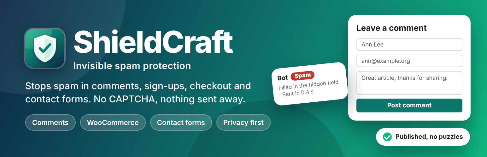
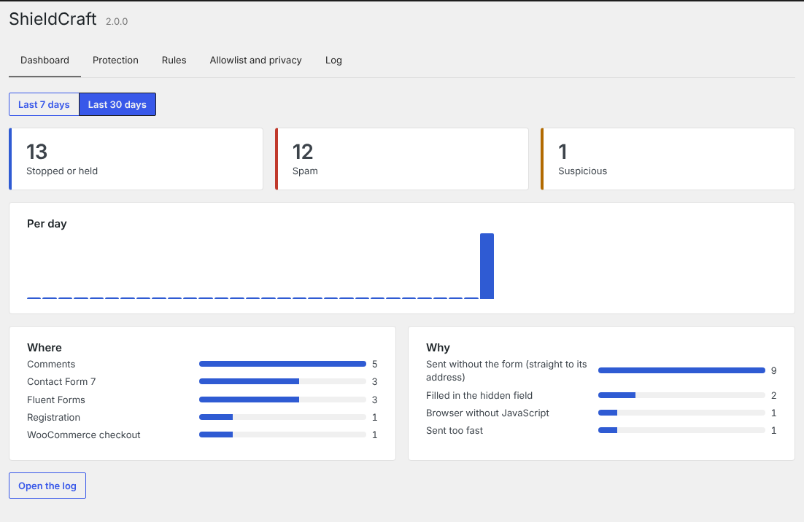
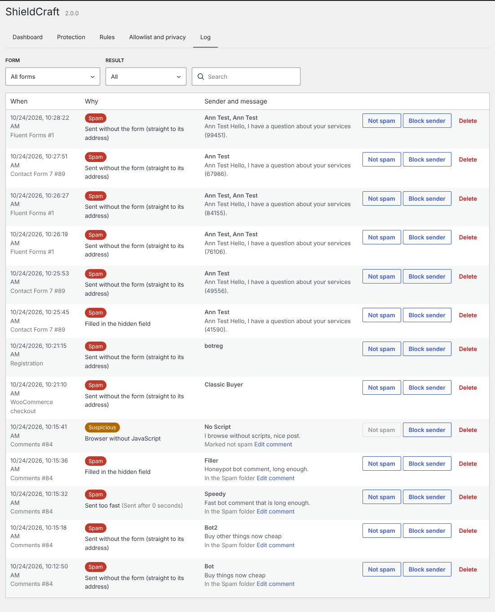
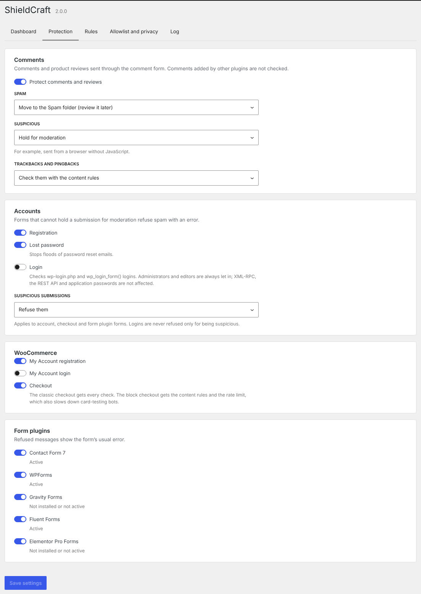
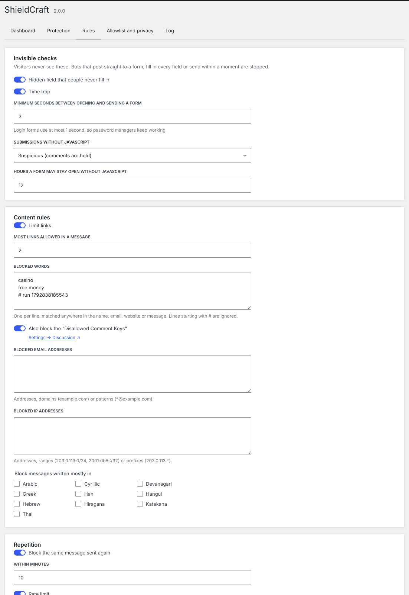
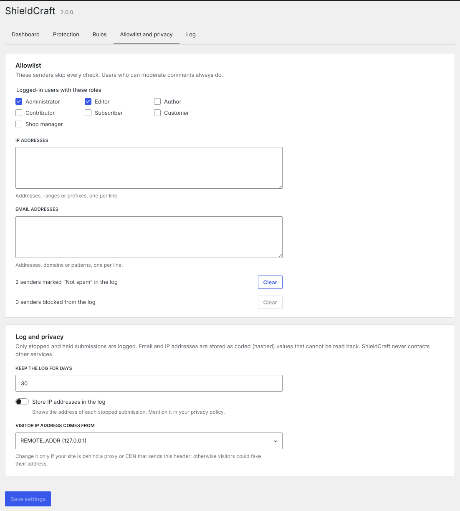
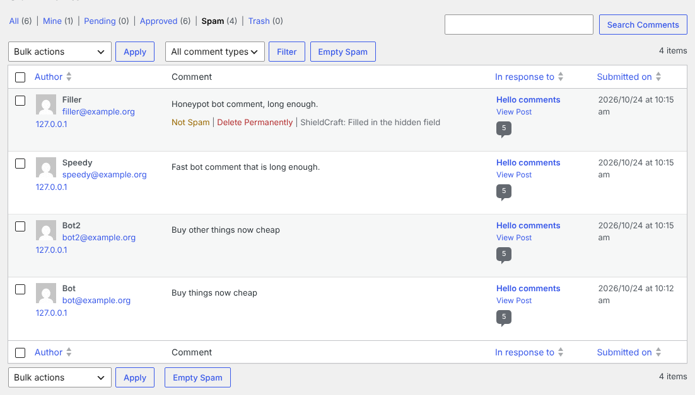

<p align="center">
  <a href="https://wordpress.org/plugins/wp-spam-protecter/"></a>
</p>

<h1>
  
  ShieldCraft – Invisible Spam Protection
</h1>

[](https://wordpress.org/plugins/wp-spam-protecter/)
[](https://wordpress.org/plugins/wp-spam-protecter/)
[](https://wordpress.org/plugins/wp-spam-protecter/)
[](https://wordpress.org/plugins/wp-spam-protecter/)
[](https://github.com/rajanvijayan/wp-spam-protecter/actions/workflows/ci.yml)
[](https://www.gnu.org/licenses/gpl-2.0.html)

Stops spam in comments, registration, WooCommerce and contact forms with invisible checks: no CAPTCHA, and nothing sent to other services. ShieldCraft is the new name and rewrite of **WP Spam Protecter**: the plugin slug is still `wp-spam-protecter`. Everything is free.

**[Download on WordPress.org](https://wordpress.org/plugins/wp-spam-protecter/)** · [Changelog](readme.txt) · [Roadmap](docs/ROADMAP-2.0.md)

## Screenshots

| Dashboard | Log |
|---|---|
| [](.wordpress-org/screenshot-1.png) | [](.wordpress-org/screenshot-2.png) |
| **Protection** | **Rules** |
| [](.wordpress-org/screenshot-3.png) | [](.wordpress-org/screenshot-4.png) |
| **Allowlist and privacy** | **Comments screen** |
| [](.wordpress-org/screenshot-5.png) | [](.wordpress-org/screenshot-6.png) |

## How it works

Every protected form gets three hidden fields: a **honeypot** text field moved off-screen, a **token** signed with a site secret for that kind of form, and a **proof** written by a small script (no jQuery). The script swaps the printed token for a fresh one from `GET /wp-json/shieldcraft/v1/token`, so pages served from a cache keep working.

On submit, the checks give a verdict: **allow**, **suspicious** or **spam**.

| Check | Verdict |
|---|---|
| No hidden fields (posted straight to the form's URL) | spam |
| Honeypot filled in | spam |
| Token forged, back-dated or from another form | spam |
| Sent within the minimum time (3 s; 1 s for logins) | spam |
| No script proof (no JavaScript) | suspicious (setting) |
| Form open longer than the token lifetime, without the script | suspicious |
| Too many links, blocked word / email / IP / range, blocked writing system | spam |
| Same message again, too many submissions per minute | spam |
| Sender blocked from the log | spam |

Allowlisted senders (roles, IP addresses, email addresses, email addresses marked "Not spam") skip every check. Suspicious comments are held for moderation; other forms refuse suspicious submissions or let them through (setting). Logins are never refused only for being suspicious.

## Protected forms

| Area | Fields | Check |
|---|---|---|
| Comments, product reviews | `comment_form` | `pre_comment_approved` (form submissions only) |
| Trackbacks, pingbacks | — | content rules, or block all |
| Registration | `register_form` | `registration_errors` |
| Lost password | `lostpassword_form` | `lostpassword_post` |
| Network sign-up | `signup_extra_fields` | `wpmu_validate_user_signup` |
| Login (opt-in) | `login_form`, `login_form_middle` | `authenticate` (wp-login.php form posts only) |
| WooCommerce registration / login | `woocommerce_register_form` / `woocommerce_login_form` | `woocommerce_process_registration_errors` / `woocommerce_process_login_errors` |
| WooCommerce classic checkout | `woocommerce_after_order_notes` | `woocommerce_after_checkout_validation` |
| WooCommerce block checkout | — | `woocommerce_store_api_checkout_update_order_from_request` (content rules, rate limit) |
| Contact Form 7 | `wpcf7_form_elements` | `wpcf7_spam` |
| WPForms | `wpforms_display_submit_before` | `wpforms_process_before` |
| Gravity Forms | `gform_submit_button` | `gform_entry_is_spam` |
| Fluent Forms | `fluentform/form_element_start` | `fluentform/validation_errors` |
| Elementor Pro Forms | `elementor/widget/render_content` | `elementor_pro/forms/validation` |

## Developer API

```php
// In your form:
<?php shieldcraft_fields( 'api' ); ?>

// Where you handle it:
$result = shieldcraft_check( 'api', array( 'name' => $name, 'email' => $email, 'message' => $message ) );
// [ 'verdict' => 'allow'|'suspicious'|'spam', 'reasons' => [ ... ], 'spam' => bool ]

if ( shieldcraft_is_spam( 'api', array( 'email' => $email, 'message' => $message ) ) ) {
	// Refuse it.
}
```

Add a context for your form with the `shieldcraft_contexts` filter (a token only works for the context it was printed for).

### REST API (`shieldcraft/v1`)

| Route | Methods | |
|---|---|---|
| `/token?context=comment,api` | GET | Fresh tokens and proofs (public, never cached) |
| `/check` | POST | Verdict for `{ context, token, js, honeypot, name, email, url, message, form }` (public; call it from the server that accepts the form) |
| `/settings` | GET, POST | Settings (administrators) |
| `/log` | GET | Log rows: `context`, `verdict`, `search`, `page`, `per_page` (administrators) |
| `/log/{id}/action` | POST | `not_spam`, `block_sender` or `delete` (administrators) |
| `/stats?days=7\|30` | GET | Dashboard numbers (administrators) |
| `/senders/{allowed\|blocked}` | DELETE | Empty a sender list (administrators) |

### Hooks

| Hook | |
|---|---|
| `shieldcraft_checks` (filter) | Add or remove checks (objects implementing `ShieldCraft\Engine\Checks\Check`) |
| `shieldcraft_verdict` (filter) | Change the verdict on a submission |
| `shieldcraft_blocked` (action) | A submission was stopped or held |
| `shieldcraft_contexts` (filter) | Kinds of forms ShieldCraft knows |
| `shieldcraft_min_seconds` (filter) | Time trap per context |
| `shieldcraft_client_ip` (filter) | The visitor's IP address |
| `shieldcraft_blocked_message` (filter) | Error shown when a form is refused |
| `shieldcraft_reason_labels` (filter) | Names of the reasons in the admin |
| `shieldcraft_loaded` (action) | ShieldCraft registered its hooks |

`define( 'SHIELDCRAFT_DISABLE', true );` in `wp-config.php` switches every check off.

## Privacy

No external requests. Only stopped and held submissions are logged (30 days by default) in `{prefix}shieldcraft_log`: time, form, reasons, name, the first 200 characters, browser family, and keyed hashes of the email and IP address (the IP itself only if enabled). Suggested privacy policy text, and personal data export and erase by email.

## Requirements

WordPress 6.5 or later and PHP 7.4 or later. WooCommerce and the form plugins are optional.

## Development

```
composer install
npm ci && npm run build
composer lint                      # PHPCS (WordPress Coding Standards)
npm run lint:js && npm run lint:css
bin/install-wp-tests.sh wordpress_test root root 127.0.0.1 latest
WP_TESTS_DIR=/tmp/wordpress-tests-lib vendor/bin/phpunit
# Optional: load plugins in the tests with WC_DIR, CF7_DIR, WPFORMS_DIR and FLUENTFORM_DIR,
# and run as multisite with WP_MULTISITE=1.
```

`vendor/` and `build/` are not committed. Releases are deployed to WordPress.org by GitHub Actions; see [`RELEASING.md`](RELEASING.md).

### Layout

| Path | |
|---|---|
| `wp-spam-protecter.php` | Plugin bootstrap (the file name is kept from 1.0) |
| `src/engine/` | Tokens, hidden fields, submissions, verdicts and the checks |
| `src/areas/` | Comments and account forms |
| `src/integrations/` | WooCommerce and form plugins |
| `src/log/` | Spam log, sender lists and privacy tools |
| `src/rest/` | REST controllers |
| `src/admin/` | Settings page, dashboard widget and comment notes |
| `src/api/functions.php` | Public PHP functions |
| `assets/src/` | Front-end script and the admin app |

## License

GPL-2.0-or-later.
